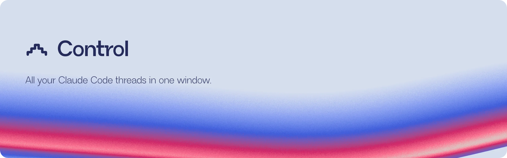
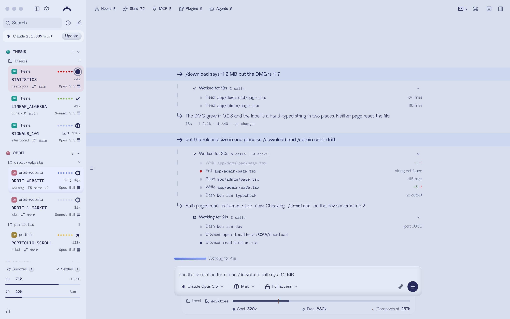
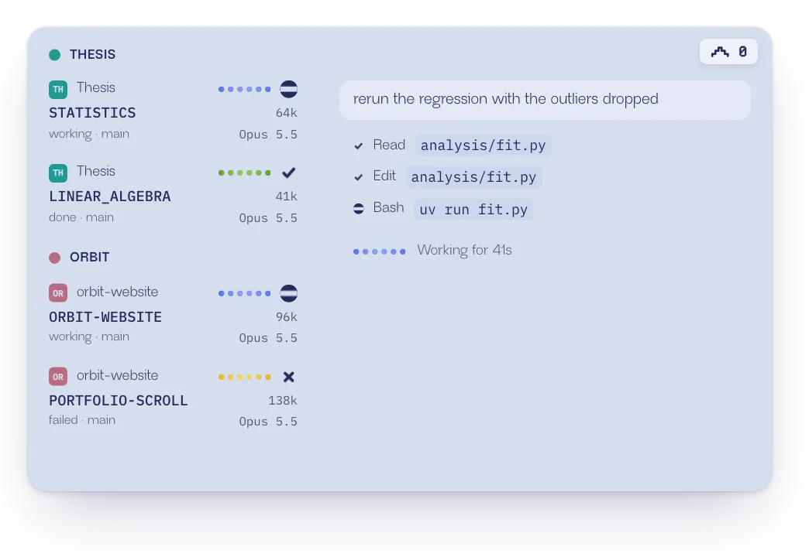
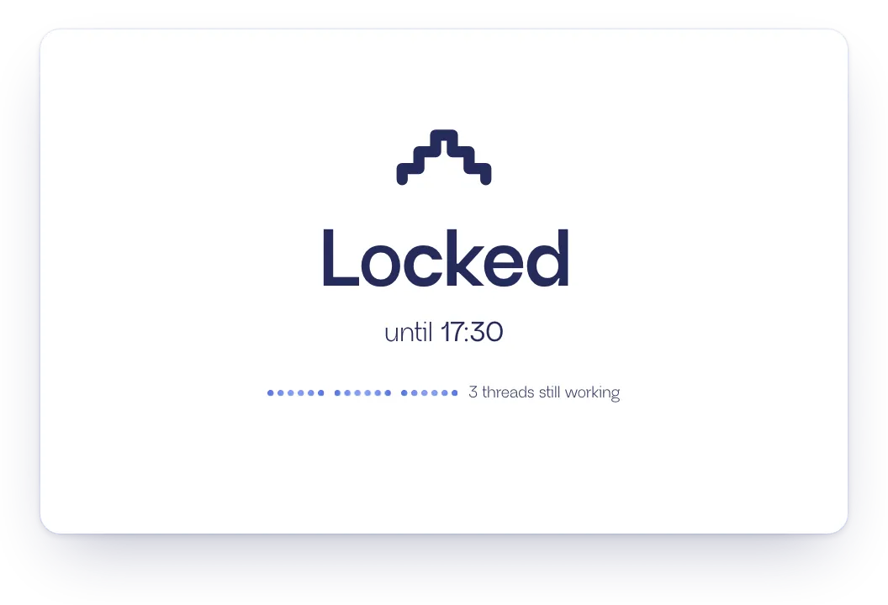
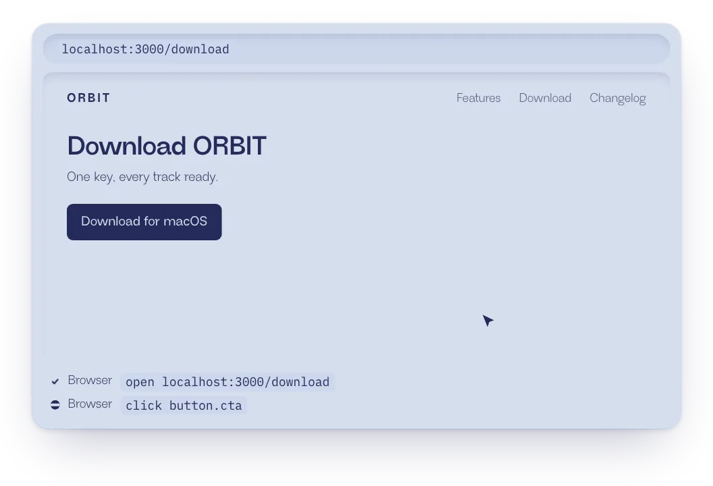
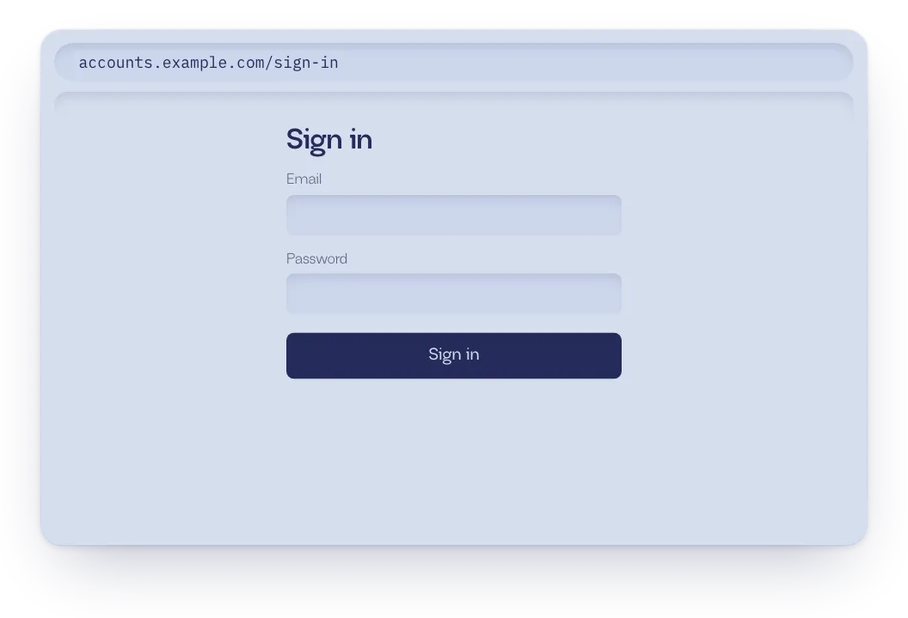
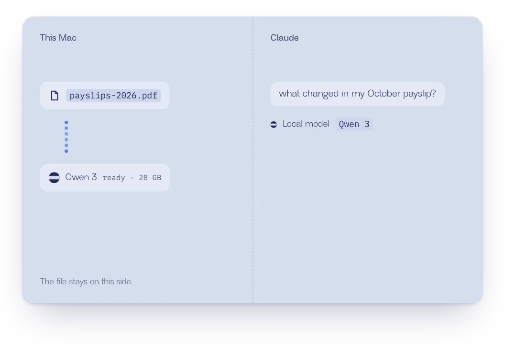
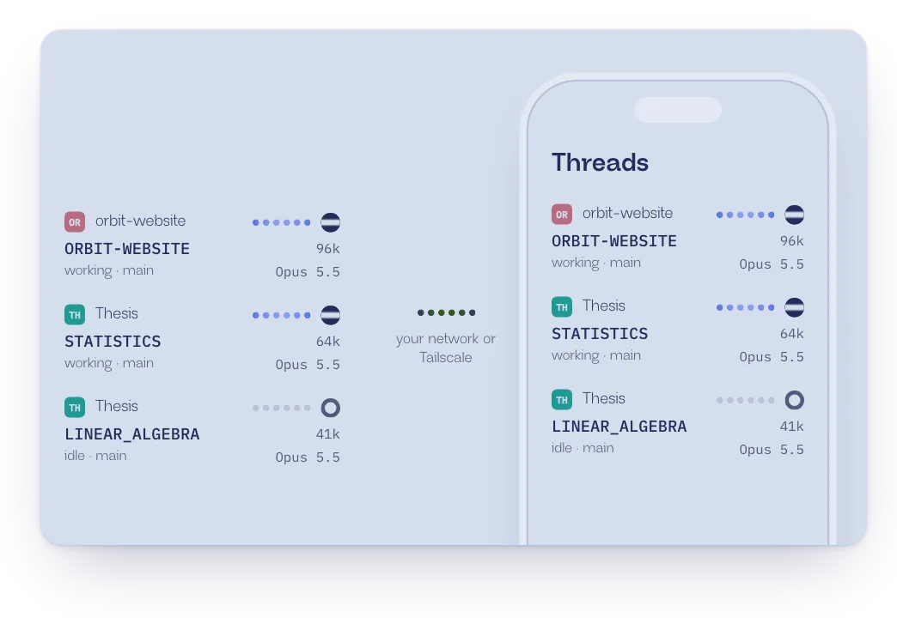

<picture>
  <source media="(prefers-color-scheme: dark)" srcset="apps/site/public/fig/banner-night.webp">
  
</picture>

<p align="center">
  <a href="https://github.com/RandevRanjit/control/releases/latest"></a>
  
  <a href="./LICENSE"></a>
  <a href="https://randevranjit.github.io/control/"></a>
</p>

Control is a Mac app for Claude Code, with a phone app beside it. It runs the `claude` you already
use, keeps every thread alive, and shows you at a glance which one is working, which is done and
which needs you.

**[Download for Mac](https://github.com/RandevRanjit/control/releases/latest)**, or see it move on
[the website](https://randevranjit.github.io/control/).

<picture>
  <source media="(prefers-color-scheme: dark)" srcset="apps/site/public/fig/app-night.jpg">
  
</picture>

## What it does

<table>
  <tr>
    <td width="50%" valign="top">
      <picture>
        <source media="(prefers-color-scheme: dark)" srcset="apps/site/public/fig/scene-needs-night.webp">
        
      </picture>
      <b>See who needs you.</b> Every thread wears its state, and the menu bar counts the ones
      waiting on you. The window can stay shut until one is.
    </td>
    <td width="50%" valign="top">
      <picture>
        <source media="(prefers-color-scheme: dark)" srcset="apps/site/public/fig/scene-lock-night.webp">
        
      </picture>
      <b>Lock yourself out.</b> Agents don't get tired, so there's never a reason to stop. Lock
      gives you one: pick a time and step away. Only a thread that needs you can call you back.
    </td>
  </tr>
  <tr>
    <td width="50%" valign="top">
      <picture>
        <source media="(prefers-color-scheme: dark)" srcset="apps/site/public/fig/scene-browser-night.webp">
        
      </picture>
      <b>A browser Claude drives.</b> Each thread gets its own tab in Control's browser. Watch it
      work through a page without it taking over your screen.
    </td>
    <td width="50%" valign="top">
      <picture>
        <source media="(prefers-color-scheme: dark)" srcset="apps/site/public/fig/scene-login-night.webp">
        
      </picture>
      <b>Signed in, for you and your agents.</b> Save a login once. Control fills it on that exact
      page, in your tabs and theirs, encrypted with a key in your Mac's Keychain.
    </td>
  </tr>
  <tr>
    <td width="50%" valign="top">
      <picture>
        <source media="(prefers-color-scheme: dark)" srcset="apps/site/public/fig/scene-local-night.webp">
        
      </picture>
      <b>Private files stay on your Mac.</b> Hand a file to a model running on your own machine.
      Claude only ever sees the answer.
    </td>
    <td width="50%" valign="top">
      <picture>
        <source media="(prefers-color-scheme: dark)" srcset="apps/site/public/fig/scene-phone-night.webp">
        
      </picture>
      <b>The same threads on your phone.</b> Pair over your own network or Tailscale and carry on
      from anywhere. No account and no cloud relay.
    </td>
  </tr>
</table>

Also in the box:

- **Groups.** Put any thread in a named group, from any folder. You decide how the sidebar is cut,
  not your file system.
- **Loose ends.** What an agent hands you to do stays pinned to its thread until it's done.
- **A checkpoint after every turn.** See what a turn changed, and restore it.
- **Usage you can see.** Your 5-hour and weekly limits sit at the foot of the sidebar. Ahead of
  pace, working threads are asked to stop spawning subagents.
- **Compaction on time.** A big idle thread is compacted while its prompt cache is still warm, so
  it costs a cache hit, not a full re-read.
- **Nothing gets lost.** Threads keep running with the window closed and come back after a crash.
  Restarting never sends a message for you.
- **Threads that talk.** Agents can see the other threads in their group and message them. Claude
  in your terminal can read them too, over MCP.
- **Your settings, in place.** Control edits `~/.claude/settings.json` where it lives and keeps the
  previous copy before every write.
- **See what a thread loaded.** Its header lists the hooks, skills, MCP servers, plugins and
  subagents it's working with.

It isn't only for code. Control started as a way to run Claude on everything: coursework, research,
job applications and admin. Agents answer with a chart or a table instead of a wall of text, open
PDFs beside the chat, fill in forms in the browser and leave you a short list of what's left.

## Install

1. Install [Claude Code](https://claude.com/product/claude-code) and sign in:

   ```bash
   claude auth login
   ```

2. Download Control from [the latest release](https://github.com/RandevRanjit/control/releases/latest)
   and drag it to Applications. Releases are signed and notarised, and the app updates itself.

Control never signs you in to anything. It runs your own `claude`, with your own Claude subscription
or API key. Usage events are kept on your Mac and nothing is sent off it; see
[product usage data](./docs/user/telemetry.md).

The iPhone app isn't on the App Store yet. Build it with your own Apple developer account by
following [apps/mobile/README.md](./apps/mobile/README.md), then pair it from
**Settings → Connections** on your Mac.

## A fork of T3 Code, for Claude only

Control is a hard fork of [T3 Code](https://github.com/pingdotgg/t3code) by T3 Tools, taken in
October 2026 under the MIT licence. T3 Code did the hard engineering, and Control wouldn't exist
without it.

- **From T3 Code:** the engine. An event-sourced server, a checkpoint after every turn with diff
  and restore, worktrees, the phone app and the MCP server.
- **Taken out:** every provider but Claude (Codex, Cursor, OpenCode, Grok, Antigravity and Pi),
  T3 Connect with its accounts and cloud relay, and the Windows and Linux desktop builds.
- **Added:** groups, thread states with a menu bar count, lock, loose ends, usage pacing,
  compaction on time, saved logins and a design of its own.

Control still takes T3 Code's fixes, about once a month
([how](./docs/operations/upstream.md)).

If you want Codex, Cursor or several providers side by side, use T3 Code. If you only use Claude and
run a lot of it, Control is built around that.

## Build from source

<a id="install-vp"></a>
Needs Node 24 and the Vite+ `vp` command-line tool:

```bash
curl -fsSL https://vite.plus | bash
```

Then, from the repository root:

```bash
vp i
vp run dev            # the server and the web client, on state of their own
vp run build:desktop  # the Mac app
```

Your real data lives in `~/.control` (override with `CONTROL_HOME`). Development and tests never
run against it; seed a sandbox with `vp run migrate-dev-db`.

Where to start reading:

- [docs/operations/development.md](./docs/operations/development.md): the dev loop, ports and state.
- [docs/internals/overview.md](./docs/internals/overview.md): how the server, the clients and
  Claude fit together.
- `apps/server` is the engine, `apps/web` the React client, `apps/desktop` wraps it for the Mac and
  `apps/mobile` is the iPhone app. `packages/contracts` holds everything that crosses the wire.

Control is a personal project. Bug, reliability and performance fixes are the most likely to land;
for anything bigger, open an issue first. [CONTRIBUTING.md](./CONTRIBUTING.md) has the rest.

## Documentation

- [Install and first run](./docs/user/install.md)
- [Threads and the sidebar](./docs/user/thread-sidebar.md)
- [The composer](./docs/user/composer.md)
- [Permission modes](./docs/user/permission-modes.md)
- [Keyboard shortcuts](./docs/user/keybindings.md)
- [Lock](./docs/user/lock.md) and [loose ends](./docs/user/loose-ends.md)
- [Saved logins](./docs/user/browser-logins.md)
- [Local models](./docs/user/local-models.md)
- [Usage](./docs/user/usage.md)
- [Remote access from a phone or another machine](./docs/user/remote-access.md)
- [Connect Claude Code, Codex and other agents over MCP](./docs/user/outside-agents.md)
- [Several Claude accounts](./docs/user/providers-claude.md)
- [Source control integrations](./docs/user/source-control.md)
- [Run Control as a background service](./docs/user/background-service.md)
- [Appearance](./docs/user/appearance.md), [project settings](./docs/user/project-settings.md)
  and [updating](./docs/user/updating.md)

Everything else is in [docs/](./docs).

## Licence

MIT. Control is not affiliated with Anthropic or T3 Tools. See [NOTICE](./NOTICE) and
[LICENSE](./LICENSE).
