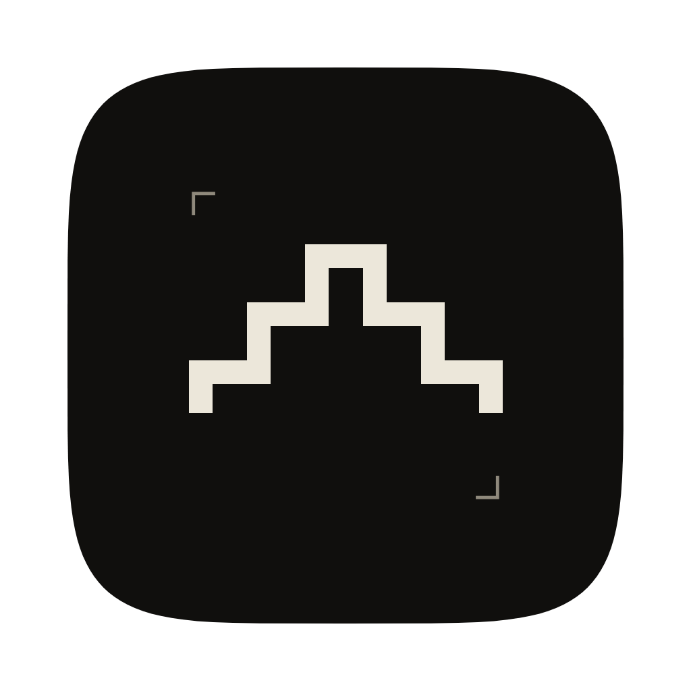
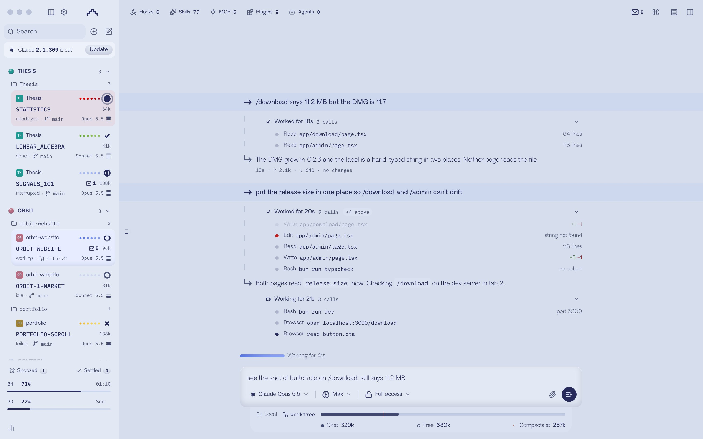

<p align="center">
  
</p>

<h1 align="center">Control</h1>

<p align="center">
  <b>All your Claude Code threads in one window.</b><br>
  Desktop, web and phone. Free and open source.
</p>

<p align="center">
  <a href="https://github.com/RandevRanjit/control/releases/latest"></a>
  
  <a href="./LICENSE"></a>
  <a href="https://randevranjit.github.io/control/"></a>
</p>

<picture>
  <source media="(prefers-color-scheme: dark)" srcset="apps/site/public/fig/app-night.jpg">
  
</picture>

Control runs the `claude` you already use, keeps every thread alive, and shows you at a glance which
one is working, which is done and which needs you. Your phone sees the same threads.

It started as a way to run Claude on everything, not only code: coursework, research, job
applications and admin. Agents answer with a chart or a table instead of a wall of text, open PDFs
in the side panel, fill in forms in the browser and leave you a short list of what's left.

## Getting started

1. Install [Claude Code](https://claude.com/product/claude-code) and sign in:

   ```bash
   claude auth login
   ```

2. Download Control from [the latest release](https://github.com/RandevRanjit/control/releases/latest)
   and drag it to Applications. Releases are signed and notarised, and the app updates itself.

Control never signs you in to anything. It runs your own `claude`, with your own Claude subscription
or API key.

## What you get

- **Know which thread needs you.** Each thread carries a bar in its state's colour, and the menu bar
  icon counts the ones waiting on you, so the window can stay shut until one is.
- **Groups.** Name a group and put any thread in it, from any folder. You decide how the sidebar is
  cut, not your file system.
- **Nothing gets lost.** Threads keep running when the window is closed. After a crash every thread
  comes back, and the ones that were mid-turn say so. Restarting never sends a message for you.
- **A checkpoint after every turn.** See what a turn changed and restore it.
- **Usage you can see.** Your 5-hour and weekly limits sit at the foot of the sidebar. When the
  5-hour window runs ahead of pace, Control asks working threads to stop spawning subagents.
- **Compaction on time.** A big thread that has sat idle is compacted while its prompt cache is
  still warm, so it costs a cache hit rather than a full re-read.
- **Lock.** Lock yourself out of a group, or everything, until a time you choose. Running work
  carries on, and anything that needs you still gets through.
- **Loose ends.** When an agent hands you something only you can do, it stays pinned to that thread
  until it's done.
- **A browser Claude drives.** Each thread gets a tab in Control's own browser, on one profile that
  stays signed in. You can watch it work without it taking over your screen.
- **Local models.** Hand private files to a model running on your Mac instead of to Claude. Only its
  answer comes back.
- **Threads that talk.** Agents can see the other threads in their group and message them, and
  Claude in your terminal can read Control's threads over MCP.
- **On your phone.** Pair a phone over your own network or Tailscale and carry on from anywhere. No
  account and no cloud relay.

## Phone

The iPhone app isn't on the App Store yet. Build it with your own Apple developer account by
following [apps/mobile/README.md](./apps/mobile/README.md), then pair it from
**Settings → Connections** on your Mac.

## Build from source

Needs Node 24 and the Vite+ `vp` command-line tool (`curl -fsSL https://vite.plus | bash`).

```bash
vp i
vp run build:desktop
```

Runtime state lives in `~/.control` (override with `CONTROL_HOME`). Development and tests must never
run against it; seed a sandbox with `vp run migrate-dev-db`. Start at
[docs/internals/overview.md](./docs/internals/overview.md).

## Documentation

- [Install and first run](./docs/user/install.md)
- [Threads and the sidebar](./docs/user/thread-sidebar.md)
- [The composer](./docs/user/composer.md)
- [Permission modes](./docs/user/permission-modes.md)
- [Keyboard shortcuts](./docs/user/keybindings.md)
- [Lock](./docs/user/lock.md) and [loose ends](./docs/user/loose-ends.md)
- [Local models](./docs/user/local-models.md)
- [Remote access from a phone or another machine](./docs/user/remote-access.md)
- [Connect Claude Code, Codex and other agents over MCP](./docs/user/outside-agents.md)
- [Several Claude accounts](./docs/user/providers-claude.md)
- [Source control integrations](./docs/user/source-control.md)
- [Run Control as a background service](./docs/user/background-service.md)
- [Appearance](./docs/user/appearance.md), [project settings](./docs/user/project-settings.md)
  and [updating](./docs/user/updating.md)

Everything else is in [docs/](./docs).

## Built on T3 Code

Control is a hard fork of [T3 Code](https://github.com/pingdotgg/t3code) by T3 Tools, under the MIT
licence. T3 Code did the hard engineering, and Control wouldn't exist without it. If you want Codex,
Cursor or several providers side by side, use T3 Code. If you only use Claude and run a lot of it,
Control is built around that.

Control is not affiliated with Anthropic or T3 Tools. See [NOTICE](./NOTICE) and [LICENSE](./LICENSE).
